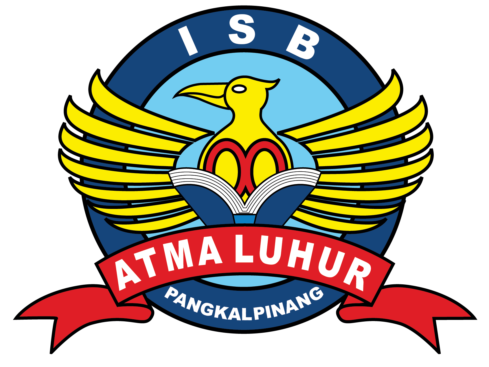

# 2611500069-PWD-TI1A-2627O

Repositori pembelajaran Pemrograman Web Dasar 2026/2027.

## Data Mahasiswa
- Nama: Surya Citra Febriyani
- NIM: 2611500069
- Kelompok: TI1A

## Deskripsi
Repositori ini berisi dokumentasi, artefak, dan tugas praktikum yang dibuat selama mata kuliah Pemrograman Web Dasar. Setiap folder pertemuan berisi hasil latihan dan pembelajaran sesuai topik modul yang dipelajari.

## Daftar Pertemuan
- [Pertemuan 1](pertemuan-01/README.md) - Konsep dasar web dan arsitektur client-server
- [Pertemuan 2](pertemuan-02/README.md) - HTML5 dasar dan struktur semantik
- [Pertemuan 3](pertemuan-03/README.md) - Formulir HTML dan CSS dasar
- [Pertemuan 4](pertemuan-04/README.md) - CSS3 layout dan responsive web design
- [Pertemuan 5](pertemuan-05/README.md) - JavaScript DOM, event, dan validasi sisi klien
- [Pertemuan 6](pertemuan-06/README.md) - PHP dasar dan pemrograman sisi server
- [Pertemuan 7](pertemuan-07/README.md) - Validasi form server-side dan event handling
- [Pertemuan 8](pertemuan-08/README.md) - Folder persiapan materi lanjutan
- [Pertemuan 9](pertemuan-09/README.md) - Folder persiapan materi lanjutan
- [Pertemuan 10](pertemuan-10/README.md) - Folder persiapan materi lanjutan
- [Pertemuan 11](pertemuan-11/README.md) - Folder persiapan materi lanjutan
- [Pertemuan 12](pertemuan-12/README.md) - Folder persiapan materi lanjutan
- [Pertemuan 13](pertemuan-13/README.md) - Folder persiapan materi lanjutan
- [Pertemuan 14](pertemuan-14/README.md) - Folder persiapan materi lanjutan
- [Pertemuan 15](pertemuan-15/README.md) - Folder persiapan materi lanjutan
- [Pertemuan 16](pertemuan-16/README.md) - Folder evaluasi akhir / proyek lanjutan

## Catatan
Setiap README pertemuan berfungsi sebagai dokumentasi pelaksanaan tugas dan hasil pembelajaran. Jika terdapat folder yang masih kosong, artinya materi atau artefak belum ditambahkan sesuai tahapan perkuliahan.